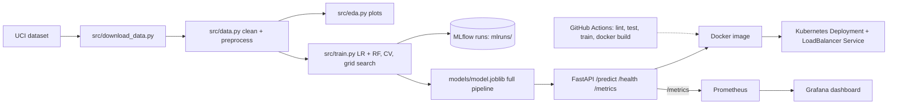

# Heart Disease Risk - MLOps Assignment 01

End-to-end pipeline: data -> EDA -> training (MLflow) -> tests/lint -> FastAPI -> Docker -> Kubernetes -> Prometheus/Grafana, with GitHub Actions CI.

## Quick start (run in the lab terminal)
```bash
cd ~/workspace
git clone https://github.com/shankarece/mlops-heart-disease.git   # later: git pull
cd mlops-heart-disease
bash scripts/run_all.sh          # checks, install, data, EDA, train, lint, tests, docker build/run, API smoke test
bash scripts/monitoring_up.sh    # Prometheus + Grafana with a ready dashboard, sends traffic, verifies
bash scripts/k8s_deploy.sh       # Minikube deploy + smoke test (Kubernetes)
```
Every script stops with a clear `ERROR:` message on failure and writes a log to `logs/`.
Use `bash scripts/run_all.sh --skip-docker` to run everything except the Docker steps.

## Architecture


## Manual commands
```bash
pip install -r requirements.txt
python -m src.download_data      # UCI Cleveland data -> data/raw/
python -m src.eda                # plots -> reports/eda/
python -m src.train              # trains LR + RF, logs to MLflow, saves models/model.joblib
mlflow ui                        # http://127.0.0.1:5000
python -m pytest -v && flake8 src tests --max-line-length=100
uvicorn src.app:app --port 8000
curl -X POST localhost:8000/predict -H "Content-Type: application/json" -d @sample_input.json
```
Docker trains the model inside the image (`docker build -t heart-api:latest .`) so training and serving always use identical library versions.

## Screenshots to take (save in `screenshots/`)
| Task | Capture |
|---|---|
| 1 EDA | files in `reports/eda/` (histograms, heatmap, class balance) |
| 3 MLflow | `mlflow ui` runs table + a run's plots/artifacts |
| 5 CI | GitHub -> Actions -> green run with artifacts |
| 6 Docker | terminal showing `docker build` end, `docker ps`, `/predict` response |
| 7 Kubernetes | `kubectl get deployments,pods,svc` and the `/predict` call |
| 8 Monitoring | Prometheus `/targets` (UP) and the Grafana "Heart Disease API" dashboard |

## Report
```bash
bash scripts/make_report.sh      # -> reports/MLOps_Assignment1_Report.docx (real metrics, EDA plots, architecture)
```
Save screenshots in `screenshots/` with these names and re-run to embed them automatically (missing ones become red placeholders):
`01_mlflow_runs.png` `02_mlflow_run_detail.png` `03_github_actions.png` `04_docker_build_run.png` `05_k8s_deploy.png` `06_prometheus_targets.png` `07_grafana_dashboard.png` `08_train_output.png`

## Repo layout
`src/` code - `tests/` pytest - `scripts/` automation - `k8s/` manifests - `monitoring/` Prometheus + Grafana - `notebooks/` - `data/` - `screenshots/` - `.github/workflows/ci.yml`
